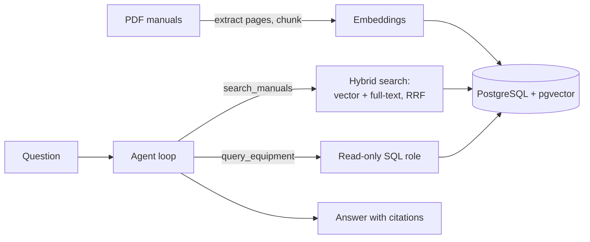

# Engineering Knowledge Assistant

A retrieval-augmented generation (RAG) assistant for plant engineers. It answers questions from PDF equipment manuals and technical specifications, cites the file and page for every fact, and can query the plant's equipment register in PostgreSQL to combine documentation with live data, for example "Which HX-200 pumps are due for service?".



## How it works

- **Ingestion**: `pypdf` extracts each page, the text is split into overlapping 120-word chunks, and each chunk is stored with its file name, page number, and embedding. Re-ingesting a file replaces its old chunks.
- **Hybrid search**: one SQL query runs a pgvector cosine search (HNSW index) and a PostgreSQL full-text search (GIN index), then merges the two rankings with reciprocal rank fusion. Keyword search catches exact terms such as model numbers; vector search catches paraphrased questions.
- **Agent with tool calling**: the model gets two tools, `search_manuals` and `query_equipment`, and decides which to call, for up to six steps. The response lists the answer, the pages it retrieved, and every SQL query it ran.
- **Safe SQL tool**: model-written SQL runs on a separate connection as the `agent_reader` role, which can only `SELECT` from `equipment`, runs in read-only transactions, has a 3-second statement timeout, and executes exactly one statement per call. Database errors go back to the model so it can correct its query.
- **Evaluation**: `eval/questions.jsonl` holds 20 questions with the file and page that answers each one. The test suite measures recall@5 and fails below 90%.

## Run it

Requirements: Docker and an API key for an OpenAI-compatible endpoint (OpenAI or Azure OpenAI).

```bash
cp .env.example .env          # add your key and model names
docker compose up -d --build
docker compose exec api python rag.py docs
```

For Azure OpenAI, set `OPENAI_BASE_URL=https://<resource>.openai.azure.com/openai/v1/` and use your deployment names for `CHAT_MODEL` and `EMBED_MODEL`. The embedding model must support 1536 dimensions (for example `text-embedding-3-small`).

Ask a question:

```bash
curl -X POST localhost:8000/ask -H "Content-Type: application/json" \
     -d '{"question": "Which HX-200 pumps are due for service?"}'
```

Search the manuals directly:

```bash
curl "localhost:8000/search?q=TR-500+winding+trip+temperature"
```

Interactive API docs are at `http://localhost:8000/docs`.

## Tests

```bash
docker compose up -d db
docker compose run --rm api python -m pytest -v -rs
```

The tests run against a real PostgreSQL database with pgvector. They cover chunking, re-ingestion, hybrid search ranking, the agent loop with both tools (using a scripted model), the SQL tool's restrictions (writes, other tables, server files, multiple statements, and timeouts are all blocked), and API input validation. The retrieval evaluation with real embeddings runs when `OPENAI_API_KEY` is set. In GitHub Actions, add it as a repository secret (plus `OPENAI_BASE_URL` for Azure).

## Repository layout

| Path | Contents |
| --- | --- |
| `rag.py` | Ingestion, hybrid search, agent loop, SQL tool, and the FastAPI app |
| `schema.sql` | `chunks` table with vector and full-text indexes, `equipment` register with sample rows, read-only role |
| `docs/` | Sample manuals: HX-200 centrifugal pump, TR-500 dry-type transformer, AC-75 air compressor |
| `eval/questions.jsonl` | 20 evaluation questions with the expected file and page |
| `tests/test_rag.py` | Integration tests and the retrieval evaluation |

The manuals and equipment data are fictional and were written for this project, so the evaluation answers are known exactly.
